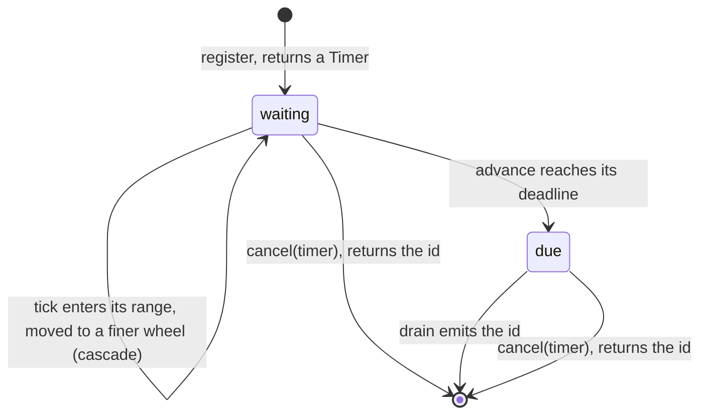
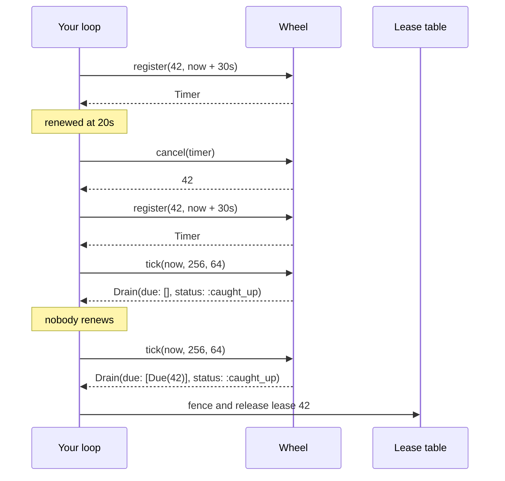

# WheelMachines

> A deadline is not an alarm. Somebody still has to look at the clock. ⏱️

An expiry index for Ruby. You register an id with the tick it expires at and get a handle back. You tell the wheel what time it is. It hands you the ids that are now due, in order, as plain data. Cancel a handle and its id never comes out. No threads, no callbacks, no clock of its own: the wheel only knows the time you gave it.

## Quick Start

```bash
gem 'wheel_machines'
```

```ruby
wheel = WheelMachines::Wheel.starting_at(clock.now_ms)

# A lease that must be renewed within 30 seconds.
timer = wheel.register(lease.id, clock.now_ms + 30_000)
raise "wheel refused #{lease.id}: #{timer}" if timer.is_a?(Symbol)

# Renewed in time? Drop the old deadline.
wheel.cancel(timer)

# In your own loop, on your own schedule:
drain = wheel.tick(clock.now_ms, 256, 64)   # now, work budget, max ids
drain.due.each { |due| expire_lease(due.id) }
reschedule_soon unless drain.caught_up?
```

One wheel, a handful of methods. Ids and ticks are Integers. A tick is whatever unit you pick, from a clock that only goes forward.

## A Message to the Resistance

So you have ten thousand leases, sessions, and retry timers, and each one expires at a different moment. You start with a `Thread.new { sleep ttl; expire(id) }` per item, and you know how that ends. So you keep a sorted set and scan it every second, and every renewal is a delete and a re-insert, and the scan holds a lock your hot path wants. So you reach for a timer library, and it owns a thread, and it calls your block on that thread, at a moment you didn't choose, while you were in the middle of something else.

What you wanted was never a timer. It was an answer to one question, asked when *you* are ready to hear it: **which of these ids are past their deadline now?** With cheap registration, cheap cancellation, and a bound on how much work the answer costs.

That index is this gem. It doesn't sleep, doesn't wake up, and doesn't call you. You ask.

## Chapter 1: Stardate 2026.316, the AMS Varghese

> **AMS Varghese**, NCC-4222, *Varghese*-class chronometer tender.
> The tender keeps the fleet's deadlines. It does not ring the bell.

The tender carries a rack of eleven wheels, sixty-four pegs each. A deadline an hour away hangs on a coarse wheel, where one peg covers a wide stretch of time. As the hour draws in, the tag is moved down to a finer wheel, and then a finer one, until it hangs on the peg for its exact tick. When the watch officer calls out the time, the quartermaster reads the tags off that peg and hands them over. What the fleet does about them is the fleet's business.

On a bridge somewhere, a cadet volunteers:

```ruby
def lease(id, ttl)
  Thread.new do
    sleep ttl
    expire(id) # unless it was renewed. Probably.
  end
end
```

"That," says the tender's quartermaster, "is ten thousand crewmen each staring at their own egg timer."

## The Flight Plan

Each registration is in one of these states:



And the afternoon a lease was renewed once and then forgotten:



## How the Wheel Works

### Register

```ruby
wheel = WheelMachines::Wheel.new          # tick starts at 0

timer = wheel.register(42, 5_000)         # id 42, due at tick 5000
timer.class                               # => WheelMachines::Timer
wheel.deadline(timer)                     # => 5000
wheel.size                                # => 1
```

A `Timer` is your handle on that one registration. The same id may be registered as often as you like. Each registration is its own entry with its own handle.

A deadline that isn't in the future is refused, not queued:

```ruby
wheel.register(43, 0)                     # => :elapsed
```

It's due already and you're holding it. Handle it.

### Cancel

```ruby
wheel.cancel(timer)        # => 42
wheel.cancel(timer)        # => nil, already gone
wheel.deadline(timer)      # => nil
```

Cancel returns the id once, and `nil` after that. A cancelled id is never emitted. An id that is due but hasn't been drained yet can still be cancelled. Once drained, its handle is dead.

### Advance

```ruby
wheel = WheelMachines::Wheel.new
wheel.register(1, 70)
wheel.register(2, 5)

wheel.advance(70)          # => :advanced
wheel.now                  # => 70
```

`advance` only moves the wheel's tick. It emits nothing and does no indexing work.

### Drain

```ruby
drain = wheel.drain(64, 64)    # work budget, max ids
drain.due                      # => [#<data WheelMachines::Due id=2, deadline=5>,
                               #     #<data WheelMachines::Due id=1, deadline=70>]
drain.status                   # => :caught_up
```

Ids come out in deadline order. Equal deadlines come out in the order they were registered. Each `Due` carries the deadline it was registered with, so `wheel.now - due.deadline` is how late you are.

`tick(now, budget, limit)` is `advance` followed by `drain`:

```ruby
wheel.tick(71, 64, 64).due     # => []
```

### Budgets and resuming

A drain stops for one of three reasons, and tells you which:

```ruby
wheel = WheelMachines::Wheel.new
5.times { |i| wheel.register(i, 9) }
wheel.advance(9)

first = wheel.drain(64, 2)
first.due.map(&:id)            # => [0, 1]
first.status                   # => :output_full

second = wheel.drain(1, 64)
second.due.map(&:id)           # => [2]
second.status                  # => :budget_spent

wheel.drain(64, 64).due.map(&:id)   # => [3, 4], status :caught_up
```

Call `drain` again and it resumes exactly where it stopped. You may register and cancel between calls.

### Cascades cost work

A tick is not free and not constant. An entry registered far ahead hangs on a coarse wheel and is moved to a finer one each time the tick enters its range. Every move is charged to the budget, just like every emitted id:

```ruby
wheel = WheelMachines::Wheel.new
wheel.register(1, 5_000)

drain = wheel.tick(5_000, 64, 64)
drain.cascaded                 # => 2
drain.due.size                 # => 1
drain.work                     # => 3
```

One registration is moved at most `WheelMachines::MAX_CASCADES` (10) times in its life, and that worst case needs a deadline 2**60 ticks out. Size your budget for the burst you can afford per loop turn; the rest waits for the next call.

### Next wake

```ruby
wheel = WheelMachines::Wheel.new
wheel.next_wake                # => nil, nothing registered
wheel.register(1, 5_000)
wheel.next_wake                # => 4096
```

`next_wake` is the tick at which a drain next has something to do. It is never later than the earliest deadline, but it can be earlier: at 4096 the wheel only moves that entry down a level. Use it to decide how long your loop may sleep. If work is already pending it returns `now`.

### Capacity

The wheel holds 1024 registrations at a time. Past that, `register` says `:full` until something is cancelled or drained:

```ruby
wheel = WheelMachines::Wheel.new
wheel.capacity                                         # => 1024
timers = 1024.times.map { |i| wheel.register(i, 100) }
wheel.register(5_000, 100)                             # => :full

wheel.cancel(timers.first)                             # => 0
wheel.register(5_000, 100).class                       # => WheelMachines::Timer
```

A live registration is never evicted to make room.

### Time only moves forward

```ruby
wheel = WheelMachines::Wheel.starting_at(100)
wheel.advance(99)              # => :regressed
wheel.tick(99, 64, 64)         # => :regressed
wheel.now                      # => 100
```

A tick earlier than the last one is refused and changes nothing. Repeating the current tick is fine.

## The Rules of the Chronometer Tender

- **Ids, ticks, budgets, and limits are Integers** in `0..2**64-1`. Floats, nil, and strings raise `TypeError`. Out of range raises `RangeError`.
- **Every tick is reachable.** Eleven wheels cover the whole 64-bit range. No deadline is too far away.
- **Timers belong to one wheel.** A `Timer` from one `Wheel` gets `nil` from another. Timers can't be built or copied by hand.
- **Refusals don't raise, and don't change anything.** `:elapsed`, `:full`, `:exhausted`, `:regressed`, and `nil` are answers. Only malformed input raises.
- **Draining never moves time.** Only `advance` and `tick` do, and only to the tick you pass.
- **Frozen means frozen.** `freeze` the wheel and `register`, `cancel`, `advance`, `drain`, and `tick` all raise `FrozenError`.

## What You Think You're Doing vs Reality

### You Think: "Timing wheels are O(1). I'll tick it in my hot path."
### Reality: Start, stop, and an empty tick are cheap. A busy tick costs what it costs.

The tick where a thousand sessions expire emits a thousand ids. The tick that crosses into a new coarse range moves everything hanging there. That work is real, so the wheel charges for it instead of hiding it: you pass a budget, it stops when the budget is spent, and `status` tells you there's more.

### You Think: "The wheel says the lease expired, so the old owner is gone."
### Reality: The wheel says a number got bigger than another number.

A due id means the tick you supplied reached the deadline you supplied. The old lease holder may still be mid-write. Revoking it takes fencing at the resource, which is not something an index can do.

### You Think: "I'll feed it my stream's watermark."
### Reality: This is scheduling time, not event time.

The wheel keeps one tick, the one you hand to `advance`. It doesn't read, hold, or advance an event-time watermark, and a due id says nothing about which events have arrived.

## What's Yours

This is an initial, unstable API around a policy core. It is not a timer runtime. You own the clock and the tick unit, the loop that calls `tick` and how often, the budget and what to do when a drain isn't caught up, and everything that happens to a due id. You own the mapping from ids to whatever they mean; the wheel stores Integers, not payloads.

The wheel lives in your process and forgets everything when the process does. If deadlines must survive a restart, keep them somewhere durable and register them again on boot. One wheel is not safe to share across threads or Ractors without your own lock.

## License

MIT License. See [LICENSE.txt](LICENSE.txt) for details.

**Remember: the wheel knows what's due. It doesn't know what time it is until you tell it.**
